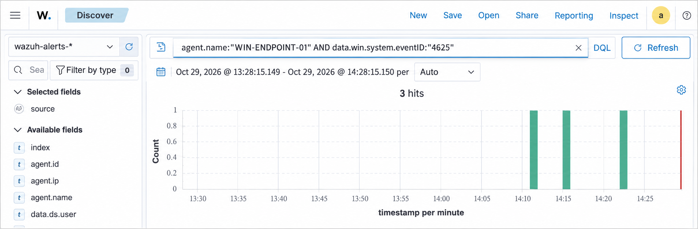

# Home SOC Lab with Wazuh

**Project status: Complete — 29 October 2026**

## Overview

This project is a small home security operations lab built to practice endpoint
monitoring, alert validation, investigation, and technical documentation. A
Wazuh all-in-one server runs on Ubuntu Server in VirtualBox and monitors a
Windows 11 endpoint named `WIN-ENDPOINT-01`.

The lab demonstrates a complete File Integrity Monitoring (FIM) investigation,
end-to-end failed-logon validation, and a tested custom PowerShell detection.
PS-001 is verified at both the Windows event layer and in the Wazuh rule engine.
Live Rule 100101 indexing was not used as a completion criterion and is not
claimed by this project.

## Architecture

```text
Windows 11 host and monitored endpoint
            |
            | Secure events over TCP 1514
            | Enrollment over TCP 1515
            v
VirtualBox localhost NAT forwarding
            |
            v
Ubuntu Server 24.04 LTS
  Wazuh manager -> Wazuh indexer -> Wazuh dashboard
```

The forwarding rules bind to `127.0.0.1`, limiting access to the local Windows
host. See `Documentation/architecture.md` for additional detail.

## Verified Results

### FIM-001 — Windows Startup folder activity

A harmless text file was created, modified, and deleted in the shared Windows
Startup directory. Wazuh detected all three events in real time:

| Rule | Level | Result |
|---:|---:|---|
| 554 | 5 | File added |
| 550 | 7 | Integrity checksum changed |
| 553 | 7 | File deleted |

The activity was investigated and classified as a **benign true positive**.

### AUTH-001 — Failed interactive logon

A single controlled Windows logon failure was generated using a nonexistent lab
account. Windows recorded Event ID `4625`, logon type 2, with status
`0xC000006D`. The event was regenerated on 2026-10-29 and verified end to end in
Wazuh Discover.

### PS-001 — PowerShell script-block telemetry

PowerShell script-block and module logging were enabled. The PowerShell
Operational channel was added to the Wazuh agent configuration, and a harmless
marked command generated Event ID `4104`. Custom Wazuh rule `100101` detects the
lab marker at level 5 and maps it to MITRE ATT&CK T1059.001. Wazuh
`wazuh-logtest` confirmed the rule produces an alert. This completes PS-001's
defined scope: endpoint telemetry plus manager-side rule validation.

## Repository Contents

```text
Detections/       Detection objectives, data sources, and analyst guidance
Documentation/    Architecture, build notes, reproduction, and troubleshooting
Evidence/         Sanitized text evidence suitable for version control
investigations/   Investigation reports and an analyst report template
Rules/            Custom Wazuh detection rules used by the lab
Screenshots/      Reviewed evidence; sensitive working images remain excluded
```

## Evidence Preview

### Service health and API availability


The API returned HTTP `401` to an unauthenticated request. This confirms that
the service was reachable and enforcing authentication; it does not represent a
successful authenticated API session.

### Active Windows endpoint


### File Integrity Monitoring results


### Failed-logon verification



The `wazuh-alerts-*` index returned three Event ID 4625 hits for the monitored
endpoint. The latest hit corresponds to the controlled test generated on
2026-10-29.

### PowerShell custom-rule verification

The sanitized [PS-001 rule-test evidence](Evidence/PS-001-rule-test.txt) records
Wazuh 4.14.7 decoding the test event, matching custom Rule 100101, and reporting
that an alert would be generated. The published
[custom rule](Rules/ps001_lab_rules.xml) is included for reproducibility.

## Skills Demonstrated

- Wazuh installation and endpoint enrollment
- Windows Security and PowerShell event-log analysis
- Custom Wazuh rule development and `wazuh-logtest` validation
- File Integrity Monitoring
- Alert triage and true-positive classification
- Hash and metadata interpretation
- MITRE ATT&CK mapping
- VirtualBox network troubleshooting
- Evidence sanitization and investigation reporting
- Git repository preparation

## Scope Boundaries

- Live endpoint-to-indexer Rule 100101 evidence is not claimed; the published
  evidence demonstrates the local event and manager rule independently.
- Sysmon and VM snapshot management are outside this project's defined scope.
- Screenshots containing Windows usernames or hostnames are intentionally
  excluded from the public repository.
- This is a learning lab, not a production architecture.

## Closure

The planned portfolio scope is complete. FIM-001, AUTH-001, and PS-001 each
include detection documentation, sanitized evidence, and an investigation
record. Sysmon, additional endpoint agents, automated response, and production
hardening would be separate projects rather than unfinished requirements here.

## Versions recorded

- Windows endpoint: Windows 11 Home `10.0.26200.9168`
- Wazuh Windows agent: `4.14.7`
- Wazuh server and rule engine: `4.14.7`
- Ubuntu server: Ubuntu Server 24.04 LTS

Exact versions should be captured again before rebuilding the lab because
installation and configuration guidance can change between releases.

## Safety and Scope

All testing was performed on systems owned by the project author. Tests used
harmless local actions, nonexistent accounts, and non-executable text files. No
external systems were targeted.
