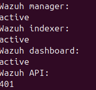
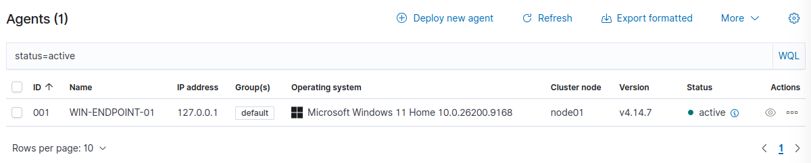
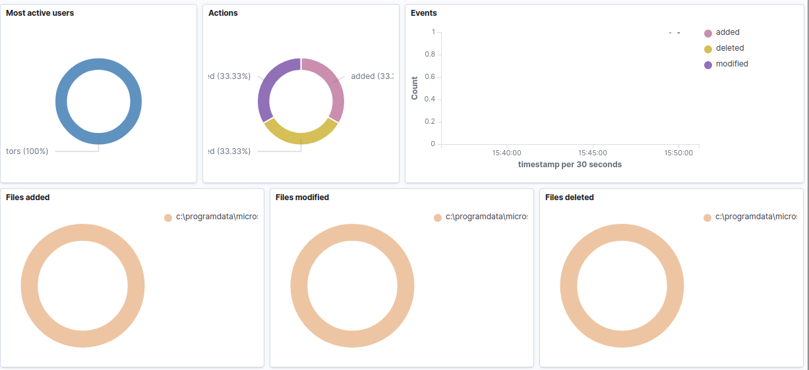
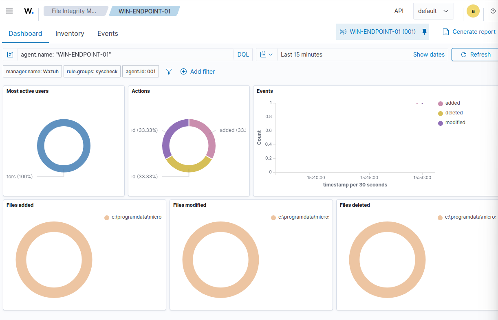
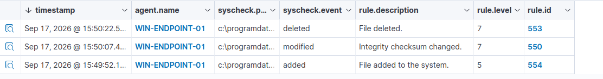

# Home SOC Lab with Wazuh

## Overview

This project is a small home security operations lab built to practice endpoint
monitoring, alert validation, investigation, and technical documentation. A
Wazuh all-in-one server runs on Ubuntu Server in VirtualBox and monitors a
Windows 11 endpoint named `WIN-ENDPOINT-01`.

The lab currently demonstrates a complete File Integrity Monitoring (FIM)
investigation and endpoint-level validation of failed-logon and PowerShell
telemetry. Results that have not yet been confirmed in the Wazuh manager are
marked as pending rather than presented as completed detections.

## Architecture

```text
Windows 11 host and monitored endpoint
            |
            | Wazuh agent traffic over TCP 1514/1515
            v
VirtualBox localhost NAT forwarding
            |
            v
Ubuntu Server 24.04 LTS
  Wazuh manager -> Wazuh indexer -> Wazuh dashboard
```

The forwarding rules bind to `127.0.0.1`, limiting access to the local Windows
host. See `Documentation/architecture.md` for additional detail.

## Verified Results

### FIM-001 — Windows Startup folder activity

A harmless text file was created, modified, and deleted in the shared Windows
Startup directory. Wazuh detected all three events in real time:

| Rule | Level | Result |
|---:|---:|---|
| 554 | 5 | File added |
| 550 | 7 | Integrity checksum changed |
| 553 | 7 | File deleted |

The activity was investigated and classified as a **benign true positive**.

### AUTH-001 — Failed interactive logon

A single controlled Windows logon failure was generated using a nonexistent lab
account. Windows recorded Event ID `4625`, logon type 2, with status
`0xC000006D`. Endpoint evidence is verified; Wazuh manager verification is
pending.

### PS-001 — PowerShell script-block telemetry

PowerShell script-block and module logging were enabled. The PowerShell
Operational channel was added to the Wazuh agent configuration, and a harmless
marked command generated Event ID `4104`. Endpoint evidence is verified; Wazuh
manager verification is pending.

## Repository Contents

```text
Detections/       Detection objectives, data sources, and analyst guidance
Documentation/    Architecture, build notes, reproduction, and troubleshooting
Evidence/         Sanitized text evidence suitable for version control
investigations/   Investigation reports and an analyst report template
Screenshots/      Reviewed evidence; sensitive working images remain excluded
```

## Evidence Preview

### Service health and API availability



### Active Windows endpoint



### File Integrity Monitoring results







## Skills Demonstrated

- Wazuh installation and endpoint enrollment
- Windows Security and PowerShell event-log analysis
- File Integrity Monitoring
- Alert triage and true-positive classification
- Hash and metadata interpretation
- MITRE ATT&CK mapping
- VirtualBox network troubleshooting
- Evidence sanitization and investigation reporting
- Git repository preparation

## Current Limitations

- AUTH-001 and PS-001 still need manager-side verification.
- Sysmon is not installed.
- A VM snapshot is deferred because the host has limited free disk space.
- Screenshots containing Windows usernames or hostnames remain excluded.
- This is a learning lab, not a production architecture.

## Next Improvements

1. Restore administrative access to the Wazuh VM and verify AUTH-001/PS-001.
2. Free additional host storage and create a known-good VM snapshot.
3. Install Sysmon and collect its Operational event channel.
4. Add a custom Wazuh rule and validate it with a harmless marker.
5. Add sanitized Windows event screenshots when available.

## Safety and Scope

All testing was performed on systems owned by the project author. Tests used
harmless local actions, nonexistent accounts, and non-executable text files. No
external systems were targeted.


